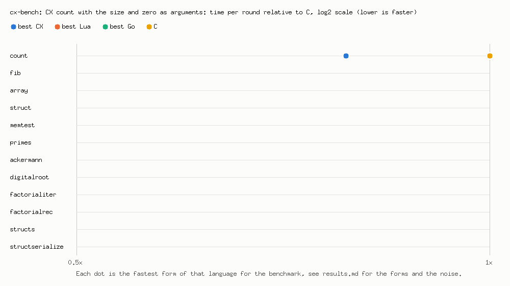

# cx-bench: CX count with the size and zero as arguments

linux/amd64, 8 logical CPUs, cx at skycoin-cx 322c0376. The c and c-wasm rows are copied from results/2026-11-27 and results/2026-11-27-wasm.

Harness: linux/amd64, 8 logical CPUs, started 2026-11-27T19:51:45-06:00.

Time per round is the time of the two passes over two times the size, from the phase markers. A form without markers (the CX forms) has it from the whole run less its empty program, marked est. A difference to C counts (sig yes) only when it is larger than the run to run spread and the placement delta of both forms. A form under a tenth of C on a benchmark is marked precomputed: its compiler worked out the result at build time and removed the work, and the best of table leaves it out.

## Best of each language, per benchmark

| benchmark | best CX | x C | best Lua | x C | best Go | x C | C | sig CX vs C |
|---|---|---:|---|---:|---|---:|---:|---|
| count | cx-llvm-wasm/turbofan 350.6 us est | 0.79 | - | - | - | - | 446.1 us | yes |
| fib | - | - | - | - | - | - | - | - |
| array | - | - | - | - | - | - | - | - |
| struct | - | - | - | - | - | - | - | - |
| memtest | - | - | - | - | - | - | - | - |
| primes | - | - | - | - | - | - | - | - |
| ackermann | - | - | - | - | - | - | - | - |
| digitalroot | - | - | - | - | - | - | - | - |
| factorialiter | - | - | - | - | - | - | - | - |
| factorialrec | - | - | - | - | - | - | - | - |
| structs | - | - | - | - | - | - | - | - |
| structserialize | - | - | - | - | - | - | - | - |

## Phases of the best forms

Load is process start to S, Loop 1 and Loop 2 the two identical passes, Finish from 2 to exit. Percent of the whole run.

| benchmark | language | form | size | Load | Loop 1 | Loop 2 | Finish | Load % | Loop 1 % | Loop 2 % | Finish % | spread % | placement % | load avg |
|---|---|---|---:|---:|---:|---:|---:|---:|---:|---:|---:|---:|---:|---|
| count | CX | cx-llvm-wasm/turbofan | 15482 | 181.5 ms est | 5408.7 ms | 5408.7 ms | in Load | 1.7 | 49.2 | 49.2 | - | 3.0 | - | 2.48-3.26 |
| count | C | c | 2548 | 661.6 us | 1139.1 ms | 1127.0 ms | 262.6 us | 0.0 | 50.2 | 49.7 | 0.0 | 1.9 | 2.1 | 2.28-2.33 |

## Every form

Sweep is the whole run, start up included, per round at size/8, /4, /2 and the size: flat means the start up is amortized. Server is the time per round the program measured itself in server mode, first and third run of one process. Self is how far the program's own -time=us loop times are from the harness markers.

| form | benchmark | size | per round | min | max | spread % | placement % | sweep /8 | /4 | /2 | x1 | server 1st | 3rd | self % | load avg |
|---|---|---:|---:|---:|---:|---:|---:|---:|---:|---:|---:|---:|---:|---:|---|
| c | count | 2548 | 446.1 us | 440.3 us | 448.8 us | 1.9 | 2.1 | 440.6 us | 448.3 us | 443.5 us | 444.9 us | 438.2 us | 442.3 us | +0.0 | 2.28-2.33 |
| c-wasm | count | 5413 | 609.6 us | 603.2 us | 615.4 us | 2.0 | - | 674.8 us | 622.5 us | 632.9 us | 615.3 us | 870.0 us | 398.5 us | -0.0 | 1.82-1.89 |
| cx-vm | count | 33 | 35.1 ms est | 33.9 ms | 37.7 ms | 10.9 | 41.7 | 34.5 ms | 35.2 ms | 36.5 ms | 35.6 ms | - | - | - | 9.85-11.02 |
| cx-image | count | 31 | 34.9 ms est | 34.2 ms | 37.4 ms | 9.4 | 2.9 | 33.4 ms | 33.5 ms | 34.2 ms | 35.3 ms | - | - | - | 7.14-7.33 |
| cx-llvm | count | 3334 | 360.1 us est | 345.9 us | 365.2 us | 5.3 | 2.5 | 355.9 us | 373.1 us | 351.2 us | 358.3 us | - | - | - | 5.35-5.78 |
| cx-llvm-wasm | count | 5768 | 703.6 us est | 694.5 us | 715.9 us | 3.0 | - | 743.9 us | 753.0 us | 694.5 us | 709.8 us | - | - | - | 3.37-4.44 |
| cx-llvm-wasm/turbofan | count | 15482 | 350.6 us est | 343.5 us | 354.0 us | 3.0 | - | 389.9 us | 369.8 us | 352.8 us | 355.2 us | - | - | - | 2.48-3.26 |
| cx-wasm | count | 13 | 454.8 ms est | 433.6 ms | 461.4 ms | 6.1 | - | 611.9 ms | 522.2 ms | 512.6 ms | 470.3 ms | - | - | - | 2.14-2.56 |
| cx-wasm/turbofan | count | 5 | 324.7 ms est | 311.7 ms | 436.8 ms | 38.5 | - | - | 4626.0 ms | 2311.6 ms | 1058.4 ms | - | - | - | 3.52-4.31 |

## Notes

* cx-llvm-wasm/turbofan: start up 181.522117ms, runs capped at 10s, under 100x start up
* cx-wasm: start up 515.587797ms, runs capped at 10s, under 100x start up
* cx-wasm/turbofan: start up 7.084461005s, runs capped at 10s, under 100x start up

## Empty program

| form | layout | start to exit | start to S |
|---|---|---:|---:|
| c | a | 574.7 us | 487.0 us |
| c | b | 615.5 us | 502.8 us |
| c-wasm | a | 59.5 ms | 55.6 ms |
| cx-image | a | 2.3 ms | - |
| cx-image | b | 1.9 ms | - |
| cx-llvm | a | 752.8 us | - |
| cx-llvm | b | 765.7 us | - |
| cx-llvm-wasm | a | 72.3 ms | - |
| cx-llvm-wasm/turbofan | a | 181.5 ms | - |
| cx-vm | a | 13.5 ms | - |
| cx-vm | b | 13.8 ms | - |
| cx-wasm | a | 515.6 ms | - |
| cx-wasm/turbofan | a | 7084.5 ms | - |
